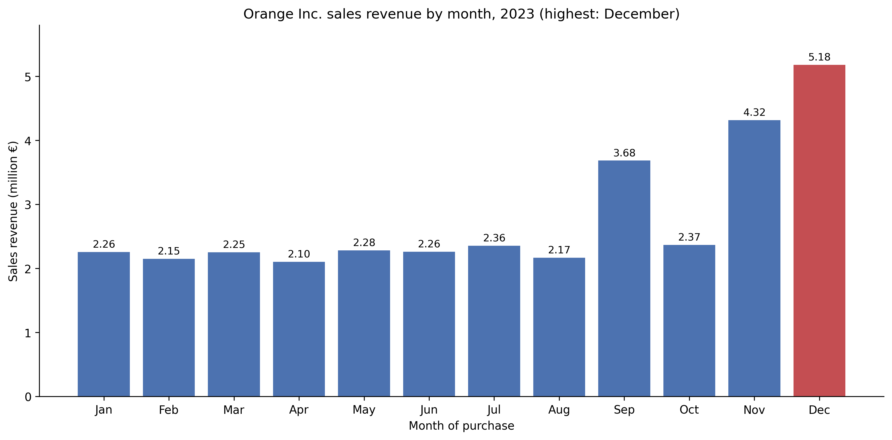
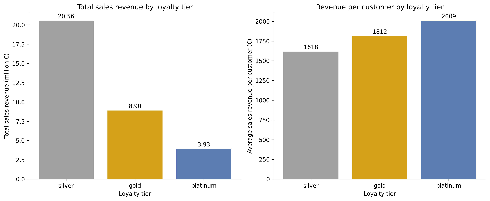
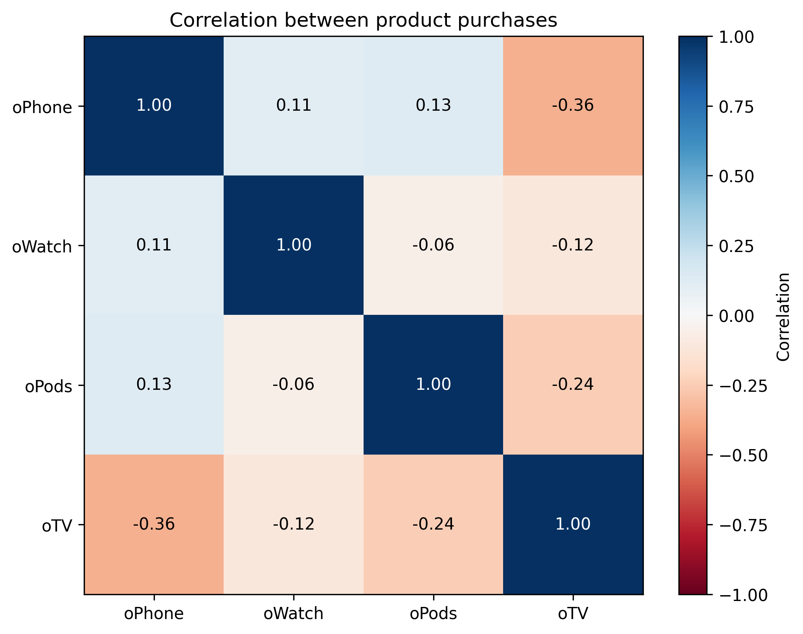

# Orange Inc. customer analytics

> Cleaning and analysis of a merged customer, product and transaction dataset for a consumer electronics company, answering descriptive and managerial questions on revenue, cross-selling and customer segments.


## TL;DR
- **Problem:** Orange Inc. merged three department databases (customers, product purchases, transactions) into one dataset of 20,000 customers and needs it cleaned and analysed.
- **Approach:** remove incomplete records, compute revenue per customer, month and product, and compare products with a correlation matrix and loyalty tiers with per-customer measures.
- **Result:** €33.4M total revenue in 2023, peaking in December (€5.18M). The silver tier brings the highest total revenue (61.6%), while platinum customers spend the most per customer (€2,009 against €1,618 for silver).
- **Stack:** Python, pandas, matplotlib, Jupyter.

## Demo




## Data
`orange_inc.csv`: 20,000 customers, 10 columns (age bracket, loyalty tier, gender, four product purchase flags, transaction date in 2023, card type). Missing cells are marked with `-`.
The dataset is provided by the course BM04BIM Big Data Management and Analytics (RSM, Erasmus University Rotterdam) and is not included in this repository. Place it in `data/orange_inc.csv`.

## Approach
1. Import the data, count missing values per column and drop the 428 incomplete rows (19,572 left).
2. Add the number of products per customer, a multiple-purchase flag, revenue per customer from the product prices, and the month of purchase.
3. Answer the descriptive questions: filtered counts, averages per tier, revenue by month and product, and a subgroup of young oPhone owners.
4. Measure which products are bought together with a correlation matrix.
5. Compare loyalty tiers on total revenue, revenue per customer and average number of products.

All steps are in [notebooks/orange_inc_analysis.ipynb](notebooks/orange_inc_analysis.ipynb).

## Results
| Measure | Value |
|---|---|
| Total revenue | €33,377,850 |
| Highest month | December, €5,180,000 |
| Revenue share | oPhone 56.2%, oTV 28.1%, oPods 8.7%, oWatch 7.0% |
| Customers with 2+ products | 12,154 of 19,572 |

| Tier | Customers | Revenue share | Revenue per customer | Avg products |
|---|---|---|---|---|
| silver | 12,707 | 61.6% | €1,618 | 1.76 |
| gold | 4,911 | 26.7% | €1,812 | 1.98 |
| platinum | 1,954 | 11.8% | €2,009 | 2.16 |

oTV buyers are the least connected to the other products: the oTV is negatively correlated with all of them, and only 40.7% of oTV buyers also bought an oPhone, against 81.3% of the other customers. Every customer bought at least one product, so these negative correlations are partly expected.



## How to run
```bash
git clone https://github.com/Mturco3/orange-inc-customer-analytics.git
cd orange-inc-customer-analytics
python -m venv .venv
.venv\Scripts\activate
pip install -r requirements.txt
# put orange_inc.csv in data/
jupyter nbconvert --to notebook --execute --inplace notebooks/orange_inc_analysis.ipynb
```
Figures are saved to `Images/`.

## Project structure
```
├── data/                      # orange_inc.csv (not tracked)
├── notebooks/
│   └── orange_inc_analysis.ipynb
├── Images/                    # figures saved by the notebook
├── requirements.txt
└── README.md
```

## Limitations and next steps
- The data holds one transaction per customer, so it shows spend in 2023, not customer lifetime value or repeat purchases.
- Revenue uses list prices; margins and loyalty programme costs are not available, so profitability per segment cannot be measured.

## Authors
Michele Turco

## License
Coursework for BM04BIM at RSM, Erasmus University Rotterdam. The dataset belongs to the course and is not redistributed.
